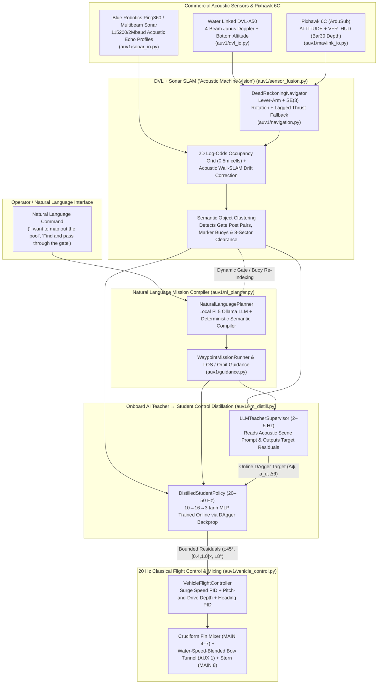

# AUV1 Autonomy Stack: DVL + Sonar "Acoustic Vision", Onboard AI Control Distillation & Natural Language Path Planning

> [!IMPORTANT]
> **Respecting the AUV1 Layering & Real-Time Control Rules (Context Brief Sections 2, 6, 8 & 9)**
> 1. **Underactuated Torpedo Physics**: AUV1 has no vertical thrusters and no Variable Buoyancy System (VBS) built yet. All depth changes use **pitch-and-drive** ($\pm 25^\circ$ pitch clamp) and require forward water speed ($u \ge 0.40\text{ m/s}$) so the cruciform stern fins (`MAIN 4–7`) do not stall.
> 2. **Strict Layering Rule**: Pure math, sensor fusion, AI distillation, and planning modules ([`navigation.py`](file:///C:/Users/nicho/.gemini/antigravity/scratch/icauv/auv1-software/auv1/navigation.py), [`sensor_fusion.py`](file:///C:/Users/nicho/.gemini/antigravity/scratch/icauv/auv1-software/auv1/sensor_fusion.py), [`guidance.py`](file:///C:/Users/nicho/.gemini/antigravity/scratch/icauv/auv1-software/auv1/guidance.py), [`nl_planner.py`](file:///C:/Users/nicho/.gemini/antigravity/scratch/icauv/auv1-software/auv1/nl_planner.py), [`llm_distill.py`](file:///C:/Users/nicho/.gemini/antigravity/scratch/icauv/auv1-software/auv1/llm_distill.py), [`vehicle_control.py`](file:///C:/Users/nicho/.gemini/antigravity/scratch/icauv/auv1-software/auv1/vehicle_control.py)) have **zero hardware/MAVLink imports**. All socket/serial traffic is isolated inside [`dvl_io.py`](file:///C:/Users/nicho/.gemini/antigravity/scratch/icauv/auv1-software/auv1/dvl_io.py), [`sonar_io.py`](file:///C:/Users/nicho/.gemini/antigravity/scratch/icauv/auv1-software/auv1/sonar_io.py), and [`mavlink_io.py`](file:///C:/Users/nicho/.gemini/antigravity/scratch/icauv/auv1-software/auv1/mavlink_io.py).
> 3. **How We Train Control on an Onboard LLM Without Breaking the 20 Hz Control Loop**: Page 9 of the brief warns that LLMs take hundreds of milliseconds to seconds per inference and cannot sit directly inside the fast PID control loop. We solve this with **Online Teacher–Student Control Distillation (DAgger)**: an onboard AI Teacher ([`LLMTeacherSupervisor`](file:///C:/Users/nicho/.gemini/antigravity/scratch/icauv/auv1-software/auv1/llm_distill.py#L46-L157)) evaluates the fused DVL+Sonar scene and trains a fast $10 \rightarrow 16 \rightarrow 3$ `tanh` neural network ([`DistilledStudentPolicy`](file:///C:/Users/nicho/.gemini/antigravity/scratch/icauv/auv1-software/auv1/llm_distill.py#L160-L296)) online in $<0.1\text{ ms}$ per tick.

---

## 1. End-to-End Autonomy Architecture

---

## 2. Pillar 1: DVL + 360° Sonar Sensor Fusion ("Acoustic Machine Vision")

Underwater cameras fail in turbid lakes or glared test tanks. By fusing a commercial **Water Linked DVL-A50** ([`dvl_io.py`](file:///C:/Users/nicho/.gemini/antigravity/scratch/icauv/auv1-software/auv1/dvl_io.py)) with a **Blue Robotics Ping360 scanning/multibeam sonar** ([`sonar_io.py`](file:///C:/Users/nicho/.gemini/antigravity/scratch/icauv/auv1-software/auv1/sonar_io.py)), [`DvlSonarFusionSLAM`](file:///C:/Users/nicho/.gemini/antigravity/scratch/icauv/auv1-software/auv1/sensor_fusion.py#L64-L353) produces a semantic scene representation just like a vision detector:

1. **Ping360 Acoustic Profile Peak Extraction ([`extract_range_from_ping360_profile`](file:///C:/Users/nicho/.gemini/antigravity/scratch/icauv/auv1-software/auv1/sonar_io.py#L46-L86))**:
   - Masks the transducer's near-field transmit ringdown ($r < 0.75\text{ m}$), applies Time-Varying Gain (TVG) compensation, and extracts range $r_{\text{beam}}$ and acoustic confidence $c \in [0, 1]$.
2. **3D Attitude-Compensated Ray Projection & Log-Odds Occupancy Grid**:
   - Projects each sonar beam using the vehicle's pitch $\theta$ and heading $\psi$ into a $100 \times 50$ log-odds grid ($0.5\text{ m}$ cells covering the $50 \times 25\text{ m}$ pool):
     $$\ell_{t}(r, c) = \operatorname{clamp}\!\Big(\ell_{t-1}(r, c) + \Delta \ell_{\text{hit/free}},\, -4.0,\, +5.0\Big)$$
3. **Acoustic Wall-SLAM Drift Correction**:
   - Even a commercial DVL accumulates $0.5\text{--}1.5\%$ position drift over long runs, and loses bottom-lock if altitude drops below $0.05\text{ m}$. Whenever high-confidence sonar returns align with the known pool perimeter walls ($\pm 25\text{ m}$ North, $\pm 12.5\text{ m}$ East), [`DvlSonarFusionSLAM.update()`](file:///C:/Users/nicho/.gemini/antigravity/scratch/icauv/auv1-software/auv1/sensor_fusion.py#L140-L246) applies a Complementary Innovation Filter (`wall_slam_gain = 0.18`) that nudges the dead-reckoned position back onto the true tank frame.
4. **Connected-Components Semantic Object Detection ([`_extract_semantic_features`](file:///C:/Users/nicho/.gemini/antigravity/scratch/icauv/auv1-software/auv1/sensor_fusion.py#L261-L329))**:
   - Clusters high-occupancy interior cells ($p > 0.69$) and classifies them by geometry:
     - **Competition Gate (`kind: "gate"`)**: Pairs of compact acoustic reflectors separated by $1.2\text{--}3.2\text{ m}$ (matching the $2.0\text{ m}$ competition gate posts), outputting the exact gate center coordinates and confidence.
     - **Marker Buoys (`kind: "buoy"`)**: Isolated compact reflectors inside the pool interior.

---

## 3. Pillar 2: Training Control on an Onboard LLM (`auv1/llm_distill.py`)

To train AUV1's controller based on an onboard LLM while maintaining hard real-time safety:

- **The Teacher ([`LLMTeacherSupervisor`](file:///C:/Users/nicho/.gemini/antigravity/scratch/icauv/auv1-software/auv1/llm_distill.py#L46-L157))**:
  - Queries either a local Raspberry Pi 5 Ollama model (`http://127.0.0.1:11434/api/generate`, e.g., `qwen2.5:1.5b` or `llama3.2:1b`) or its built-in expert tactical supervisor using [`DvlSonarFusionSLAM.to_llm_scene_prompt()`](file:///C:/Users/nicho/.gemini/antigravity/scratch/icauv/auv1-software/auv1/sensor_fusion.py#L331-L353).
  - Outputs bounded tactical residuals:
    $$\mathbf{y}_{\text{teacher}} = \begin{bmatrix} \Delta\psi_{\text{sp}} \in [-45^\circ, +45^\circ] \\ \alpha_{u} \in [0.40, 1.00] \\ \Delta\theta_{\text{sp}} \in [-8^\circ, +8^\circ] \end{bmatrix}$$
- **The Student ([`DistilledStudentPolicy`](file:///C:/Users/nicho/.gemini/antigravity/scratch/icauv/auv1-software/auv1/llm_distill.py#L160-L296))**:
  - A pure-Python $10 \rightarrow 16 \rightarrow 3$ `tanh` Multi-Layer Perceptron that takes the 10-D normalized state vector ([`build_feature_vector`](file:///C:/Users/nicho/.gemini/antigravity/scratch/icauv/auv1-software/auv1/llm_distill.py#L22-L43): surge $u$, sway $v$, cross-track error $e_y$, heading error, DVL altitude, and 5 forward sonar sector clearances).
  - Every time the Teacher evaluates a scene, [`student.train_step(features, target, lr=0.03)`](file:///C:/Users/nicho/.gemini/antigravity/scratch/icauv/auv1-software/auv1/llm_distill.py#L211-L260) performs analytical backpropagation online (DAgger / Dataset Aggregation) and persists learned weights to JSON.
  - Even if the Student outputs an extreme value, it only feeds **bounded setpoint residuals** into [`VehicleFlightController.update()`](file:///C:/Users/nicho/.gemini/antigravity/scratch/icauv/auv1-software/auv1/vehicle_control.py#L84-L165), so the inner-loop pitch clamp ($\pm 25^\circ$), minimum fin flow speed ($0.40\text{ m/s}$), and DVL floor guard ($0.35\text{ m}$) can never be violated.

---

## 4. Pillar 3: Natural Language $\rightarrow$ Path & Trajectory Compiler (`auv1/nl_planner.py`)

[`NaturalLanguagePlanner.compile_command()`](file:///C:/Users/nicho/.gemini/antigravity/scratch/icauv/auv1-software/auv1/nl_planner.py#L64-L120) translates operator instructions into executable [`Waypoint`](file:///C:/Users/nicho/.gemini/antigravity/scratch/icauv/auv1-software/auv1/guidance.py#L18-L25) sequences:

| Natural Language Command Example | Compiled Mission Type | Generated Trajectory & Underactuated Behavior |
| :--- | :--- | :--- |
| *"I want to map out the pool at 1.5m depth"* | `lawnmower_map` | 8-waypoint Boustrophedon lawnmower survey across 4 East-West lanes at $0.85\text{ m/s}$ so Ping360 sweeps $100\%$ of the tank |
| *"Find and pass through the gate"* | `gate_passage` | Queries `detected_features` from `DvlSonarFusionSLAM`; aligns $5\text{ m}$ upstream of the detected gate posts, drives through center, and exits $6\text{ m}$ beyond |
| *"Inspect the perimeter walls"* | `perimeter_inspection` | 4-corner closed loop inset $3.5\text{ m}$ from the concrete walls to maximize Sonar Wall-SLAM lock |
| *"Orbit the marker buoy at 1.8m depth"* | `buoy_orbit` | Constant-speed circular loiter around the acoustically detected buoy (since AUV1 cannot hover at $u=0$) |
| *"Go to north 16 east -4 at 1.4m depth"* | `custom_coordinates` | Extracts exact `(North, East, Depth)` coordinates and clamps them inside safe pool boundaries |

---

## 5. Summary of Files Added & Updated

### `auv1-software` (`C:\Users\nicho\.gemini\antigravity\scratch\icauv\auv1-software`)
- [`auv1/dvl_io.py`](file:///C:/Users/nicho/.gemini/antigravity/scratch/icauv/auv1-software/auv1/dvl_io.py): Water Linked DVL-A50 TCP JSON (`:16171`) & NMEA `$WRZ` driver (`enabled=False` default flag).
- [`auv1/sonar_io.py`](file:///C:/Users/nicho/.gemini/antigravity/scratch/icauv/auv1-software/auv1/sonar_io.py): Blue Robotics Ping360 / multibeam sonar driver & profile range/confidence extractor (`enabled=False` default flag).
- [`auv1/navigation.py`](file:///C:/Users/nicho/.gemini/antigravity/scratch/icauv/auv1-software/auv1/navigation.py): [`DeadReckoningNavigator`](file:///C:/Users/nicho/.gemini/antigravity/scratch/icauv/auv1-software/auv1/navigation.py#L64-L216) with lever-arm compensation and lagged-thrust fallback.
- [`auv1/sensor_fusion.py`](file:///C:/Users/nicho/.gemini/antigravity/scratch/icauv/auv1-software/auv1/sensor_fusion.py): [`DvlSonarFusionSLAM`](file:///C:/Users/nicho/.gemini/antigravity/scratch/icauv/auv1-software/auv1/sensor_fusion.py#L64-L353) Log-Odds Occupancy Grid, Wall-SLAM drift correction, and Gate/Buoy detector.
- [`auv1/nl_planner.py`](file:///C:/Users/nicho/.gemini/antigravity/scratch/icauv/auv1-software/auv1/nl_planner.py): [`NaturalLanguagePlanner`](file:///C:/Users/nicho/.gemini/antigravity/scratch/icauv/auv1-software/auv1/nl_planner.py#L40-L258) natural language to waypoint compiler.
- [`auv1/llm_distill.py`](file:///C:/Users/nicho/.gemini/antigravity/scratch/icauv/auv1-software/auv1/llm_distill.py): [`LLMTeacherSupervisor`](file:///C:/Users/nicho/.gemini/antigravity/scratch/icauv/auv1-software/auv1/llm_distill.py#L46-L157) & [`DistilledStudentPolicy`](file:///C:/Users/nicho/.gemini/antigravity/scratch/icauv/auv1-software/auv1/llm_distill.py#L160-L296) online DAgger neural distillation.
- [`auv1/guidance.py`](file:///C:/Users/nicho/.gemini/antigravity/scratch/icauv/auv1-software/auv1/guidance.py): [`los_heading_deg`](file:///C:/Users/nicho/.gemini/antigravity/scratch/icauv/auv1-software/auv1/guidance.py#L33-L73), [`orbit_guidance`](file:///C:/Users/nicho/.gemini/antigravity/scratch/icauv/auv1-software/auv1/guidance.py#L76-L108), and [`resolve_depth_setpoint`](file:///C:/Users/nicho/.gemini/antigravity/scratch/icauv/auv1-software/auv1/guidance.py#L111-L143).
- [`auv1/vehicle_control.py`](file:///C:/Users/nicho/.gemini/antigravity/scratch/icauv/auv1-software/auv1/vehicle_control.py): Added surge speed PID (`u_mps`, `speed_sp_mps`) and water-speed bow thruster blending.
- [`scripts/mission_ai_sonar.py`](file:///C:/Users/nicho/.gemini/antigravity/scratch/icauv/auv1-software/scripts/mission_ai_sonar.py): Unified CLI mission script (`--command "I want to map out the pool"`, `--dvl-enabled`, `--sonar-enabled`, `--train-dagger`).
- [`tests/test_dvl_autonomy.py`](file:///C:/Users/nicho/.gemini/antigravity/scratch/icauv/auv1-software/tests/test_dvl_autonomy.py): Deterministic unit tests for DVL, Ping360 Sonar SLAM, NL Planning, and DAgger MLP convergence.

### `auv1-sim` (`C:\Users\nicho\.gemini\antigravity\scratch\icauv\auv1-sim`)
- [`config/pool.json`](file:///C:/Users/nicho/.gemini/antigravity/scratch/icauv/auv1-sim/config/pool.json) & [`config/vehicle.json`](file:///C:/Users/nicho/.gemini/antigravity/scratch/icauv/auv1-sim/config/vehicle.json): Added competition gate posts, marker buoys, DVL parameters, and 360° sonar parameters.
- [`auv1sim/sensors.py`](file:///C:/Users/nicho/.gemini/antigravity/scratch/icauv/auv1-sim/auv1sim/sensors.py), [`auv1sim/estimator.py`](file:///C:/Users/nicho/.gemini/antigravity/scratch/icauv/auv1-sim/auv1sim/estimator.py), [`auv1sim/sim_link.py`](file:///C:/Users/nicho/.gemini/antigravity/scratch/icauv/auv1-sim/auv1sim/sim_link.py): Added simulated DVL and 360° Sonar raycasting (`read_dvl()`, `read_sonar()`, `sonar_wall_slam_correct()`).
